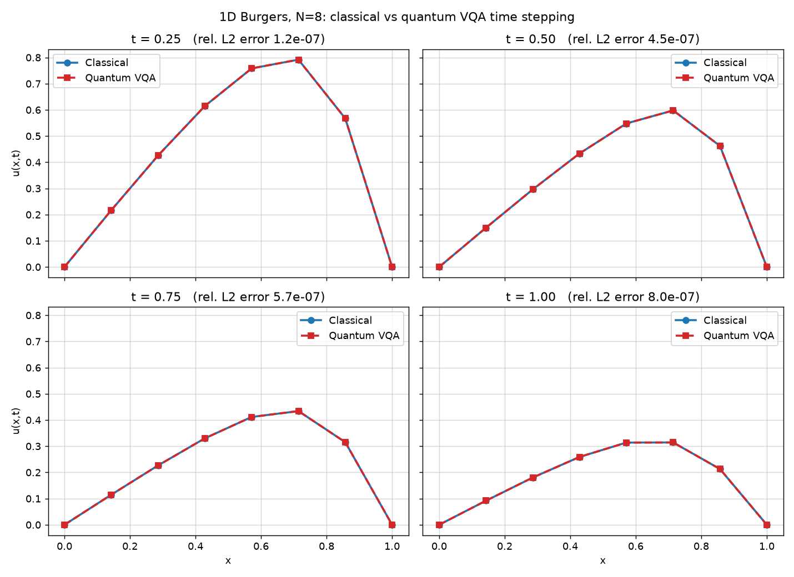
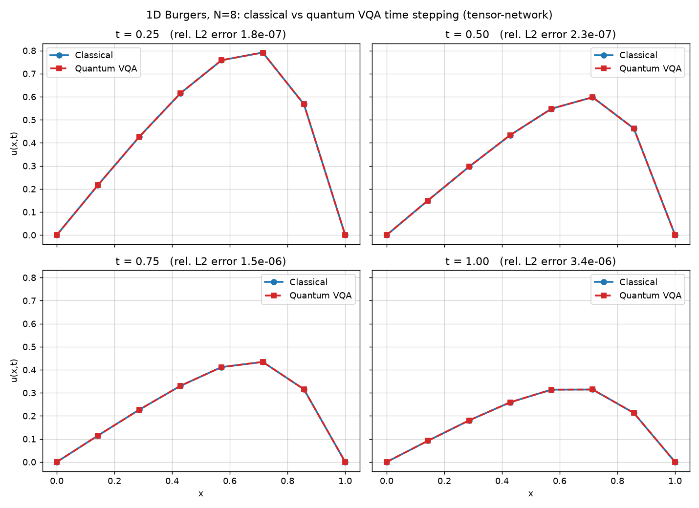
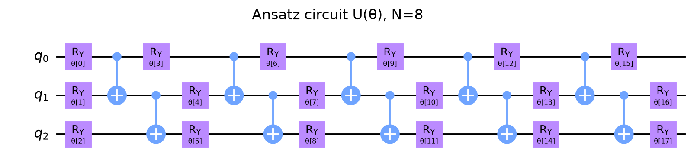
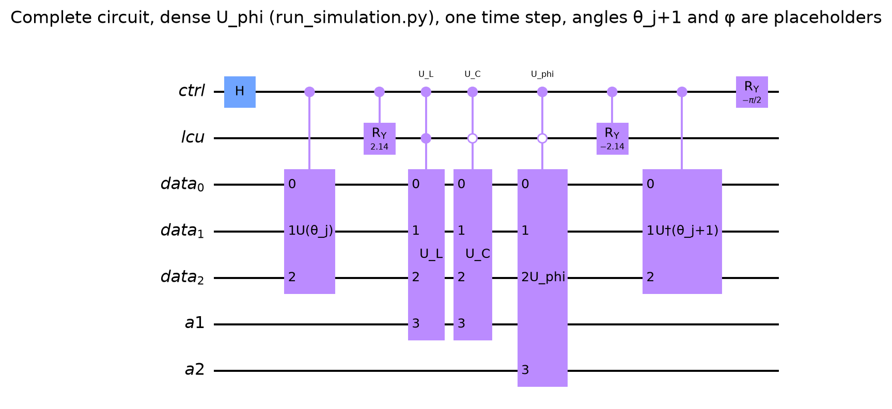
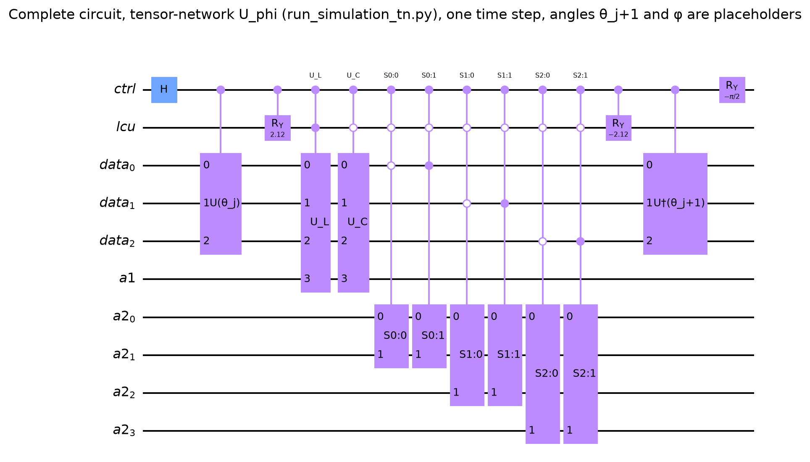
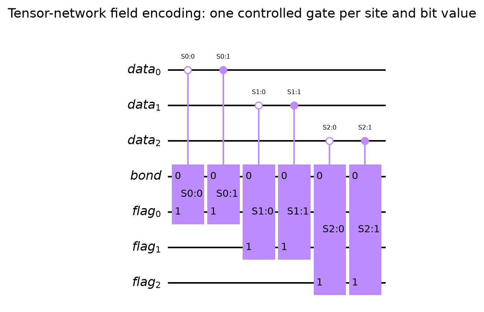

# Hybrid Tensor-Network Quantum CFD

A small hybrid quantum-classical prototype for time-stepping the one-dimensional viscous Burgers equation. It stores a discretized flow field in the amplitudes of a variational quantum circuit, builds the nonlinear update from the current field, and compares each step with a classical finite-difference solution.

## Hackathon pitch

**Problem:** Nonlinear fluid equations are difficult to represent as quantum operations because the update depends on the current solution.

**Approach:** Encode the normalized velocity field in data-qubit amplitudes. Represent diffusion and the derivative as block-encoded operators, and represent the current field as a diagonal operator. A classical optimizer then tunes a parameterized circuit to approximate the next time step. A second implementation builds the field operator from a tensor-train representation.

**Demo:** Run either simulator and view the saved plots comparing the hybrid result with the classical reference. For the supplied N=8 example, the dense comparison plot reports relative L2 errors around 1e-7 to 8e-7; the tensor-network plot reports around 2e-7 to 3e-6.

**What makes it interesting:** It shows how a nonlinear update can be assembled from a fixed linear part and a field-dependent part, and how tensor-network structure can replace a dense field encoding.

This is a research prototype and learning demo. The supplied runs use ideal Qiskit statevector simulation; they do not demonstrate a quantum-hardware speedup.

## How one time step works

1. A classical finite-difference solver creates the reference solution.
2. The initial normalized field is fitted by a circuit made from RY and CX gates.
3. Controlled block-encoded operators apply the diffusion and nonlinear terms using the current field.
4. A classical optimizer adjusts the next circuit angles and a rotation angle used to recover the field norm.
5. The process repeats, and the hybrid field is plotted against the classical reference.

For the end-to-end derivation, see [MATHEMATICAL_DESCRIPTION.md](MATHEMATICAL_DESCRIPTION.md).

## Figures

### Classical reference and hybrid result

### State-preparation ansatz

### Dense field-encoding time-step circuit

### Tensor-network time-step circuit

### Local tensor-network field gates

The complete-circuit drawings show one time step. Their next-step angles and φ are placeholders in the generated circuit image.

## Qubit guide

For N grid values, the data register uses log2(N) qubits. At N=8, data0 carries the least-significant index bit, data1 the middle bit, and data2 the most-significant bit under Qiskit's basis indexing. The remaining qubits hold the control, the linear-combination selector, and block-encoding work ancillas. All ancillas start at |0>; successful operator blocks are read from the all-zero ancilla subspace.

| Register | Dense version | Tensor-network version | Role |
|---|---:|---:|---|
| ctrl | 1 qubit | 1 qubit | Interference control. The Hadamard creates reference and update branches used to compare the candidate next state. |
| lcu | 1 qubit | 1 qubit | Selects the linear diffusion branch or the field-dependent nonlinear branch. Controlled RY rotations prepare and then recombine these branches. |
| data | log2(N) qubits | log2(N) qubits | Holds the grid-index amplitudes of the normalized field. For N=8, data0, data1, and data2 encode the three bits of an index from 0 to 7. |
| a1 | 1 qubit | 1 qubit | Block-encoding flag for the linear and derivative operators U_L and U_C. |
| a2 | 1 qubit | bond + log2(N) flag qubits | Dense version: flag for U_phi. Tensor-network version: bond register plus one local dilation flag per data site. |

The exact bit ordering follows Qiskit's little-endian convention in the code.

## Gate guide

| Gate or block | What it does here |
|---|---|
| H on ctrl | Creates the two branches whose interference reveals overlap with the proposed next state. |
| RY(θ) on each data qubit | Trainable one-qubit rotations. Their angles define the variational field state. |
| CX from data q to q+1 | Entangles neighboring data qubits so the ansatz can represent a non-product field state. |
| Controlled U(θ_j) | Prepares the current normalized field on the active control branch. |
| Controlled U_L | Encodes identity plus the viscous-diffusion update. |
| Controlled U_C | Encodes the spatial derivative, including its minus sign. |
| Controlled U_phi | Dense version of the diagonal operator formed from the current field amplitudes. |
| S{k}:{i} gates | Tensor-network replacement for U_phi. Each is a controlled local dilation for site k and bit value i, using the bond and flag qubits. |
| CRY(ω), then CRY(-ω) | Weight and recombine the two operator branches so their selected block represents the sum of the linear and nonlinear updates. |
| Controlled U†(θ_{j+1}) | Unprepares a candidate next state on the active branch, turning state agreement into an overlap measurement. |
| RY(-φ) on ctrl | Sets the measurement balance used to estimate the update norm. |
| Conditional ⟨Z⟩ readout | This is a measurement, not a Z gate in the circuit. The optimizer drives the postselected control expectation toward 1. |

U_L, U_C, U_phi, and S{k}:{i} are high-level unitary blocks in the diagrams. Each is built as a unitary dilation of a matrix, rather than expanded into hardware-native one- and two-qubit gates.

## Run it

From the project directory:

    python3 -m pip install -r requirements.txt
    python3 experiments/run_simulation.py

To use the tensor-network field encoding:

    python3 experiments/run_simulation_tn.py

Both scripts use N=8 by default and save their comparison figures under results/figures/. In the current scripts, SHOTS=None means the optimizer uses exact statevector probabilities. A finite-shot sampling path is present, but the default plots are not hardware or noisy-device results.

## Project map

- src/qcfd/burgers.py — grid, finite-difference operators, and classical reference solver.
- src/qcfd/block_encoding.py — unitary dilation for dense matrices.
- src/qcfd/circuit_vqa.py — normalization and fidelity relations, plus conditional Z estimation.
- src/qcfd/tensor_network.py — tensor-train construction and local field-operator compilation.
- experiments/run_simulation.py — dense field-encoding experiment.
- experiments/run_simulation_tn.py — tensor-network field-encoding experiment.
- experiments/draw_circuits.py — regenerates the circuit diagrams.
- notebooks/final_model_walkthrough.ipynb — interactive walkthrough.
- MATHEMATICAL_DESCRIPTION.md — connected mathematical description from the PDE to the circuit update.

## References

The following works informed the ideas and methods explored in this project. The code in this repository is our own implementation, written with these references as guidance; it is not copied from or distributed by the paper authors.

1. Pia Siegl, Nis-Luca van Hülst, Maximilian Mandelt Buxadé, Tomohiro Hashizume, and Dieter Jaksch, “Efficient Treatment of Non-Linearity in Quantum Computational Fluid Dynamics Using Hybrid Tensor Networks,” arXiv:2608.24150v1 (2026). [arXiv](https://arxiv.org/abs/2608.24150)
2. Pia Siegl, Greta Sophie Reese, Tomohiro Hashizume, Nis-Luca van Hülst, and Dieter Jaksch, “Tensor-Programmable Quantum Circuits for Solving Differential Equations,” arXiv:2502.04425v2 (2025). [arXiv](https://arxiv.org/abs/2502.04425)
3. Shi-Ju Ran, “Encoding of Matrix Product States into Quantum Circuits of One- and Two-Qubit Gates,” arXiv:1908.07958v2 (2020). [arXiv](https://arxiv.org/abs/1908.07958)
4. Román Orús, “A Practical Introduction to Tensor Networks: Matrix Product States and Projected Entangled Pair States,” arXiv:1306.2164v3 (2014). [arXiv](https://arxiv.org/abs/1306.2164)
