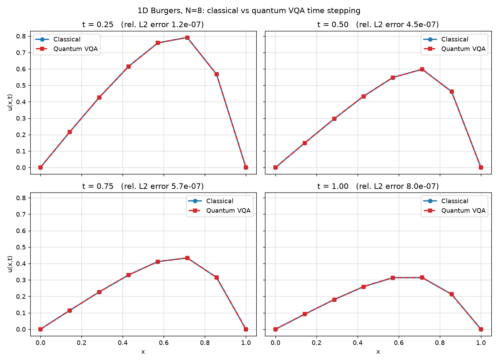
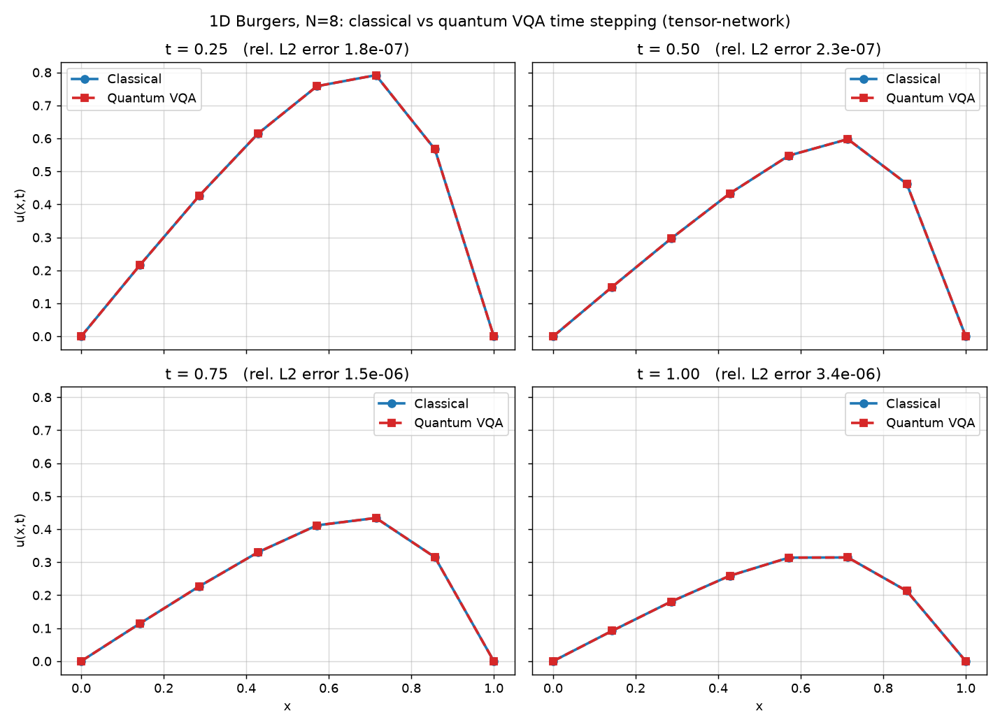

# Hybrid Tensor-Network Quantum CFD

A small, statevector-simulated prototype for time-stepping the one-dimensional viscous Burgers equation with a variational quantum circuit. It compares two ways to encode the nonlinear velocity field:

1. **Dense diagonal block encoding** (`experiments/run_simulation.py`): directly block-encodes the diagonal matrix formed from the current solution.
2. **Tensor-train (TT) encoding** (`experiments/run_simulation_tn.py`): factors the variational state into a matrix product state and compiles its diagonal operator from local cores.

The project is intended as a hackathon-scale algorithm demonstration. The code uses Qiskit's classical `Statevector` simulator and SciPy optimizers; it does not run on quantum hardware or demonstrate a quantum speedup.

## How the pieces fit together

```text
Burgers PDE
   ↓ finite differences in space, forward Euler in time
u[j+1] = O_full(u[j]) u[j]
   ↓ represent u[j] as norm × normalized circuit state
O_full = diffusion map + diagonal(field) × convection map
   ↓ block encode each map and combine with a one-qubit LCU selector
prefix circuit prepares a scaled O_full |psi[j]> branch
   ↓ compare that branch with a candidate ansatz state
optimize the next circuit parameters and a comparison angle
   ↓ recover the field norm and repeat
```

The tensor-network version changes how the diagonal field operator is compiled. The PDE discretization, linear operators, LCU time step, variational comparison, and norm update are otherwise the same.

## Repository map

| Path | Purpose |
|---|---|
| `src/qcfd/burgers.py` | Grid, finite-difference matrices, time-step selection, and classical reference solver. |
| `src/qcfd/block_encoding.py` | Dense unitary dilation used to block-encode a matrix. |
| `src/qcfd/circuit_vqa.py` | LCU normalization and fidelity expressions, plus conditional-Z probability processing. |
| `src/qcfd/tensor_network.py` | Circuit-to-TT conversion, diagonal TT operator construction, gauge selection, and local unitary dilations. |
| `experiments/run_simulation.py` | Dense-field VQA simulation and classical comparison. |
| `experiments/run_simulation_tn.py` | Tensor-network-field VQA simulation and classical comparison. |
| `tests/` | Tests for the finite-difference setup, dense block encoding, TT state representation, and compiled diagonal operator. |
| `notebooks/` | Exploratory notebooks for the model and its encodings. |
| `results/figures/` | Example comparison plots produced by the scripts. |

## 1. From Burgers equation to a discrete update

The continuous equation is

$$
\frac{\partial u}{\partial t} + u\frac{\partial u}{\partial x}
= \nu\frac{\partial^2 u}{\partial x^2},
$$

where `u(x,t)` is the velocity field and `ν` is the kinematic viscosity. Rearranging gives an evolution equation:

$$
u_t = \nu u_{xx} - u u_x.
$$

The code places `N` equally spaced points on `[0, L_dom]`, with `dx = L_dom/(N-1)`. For interior point `i`, it uses centered differences:

$$
(D_1u)_i = \frac{u_{i+1}-u_{i-1}}{2\,dx}, \qquad
(D_2u)_i = \frac{u_{i-1}-2u_i+u_{i+1}}{dx^2}.
$$

Thus `D1` approximates the first spatial derivative and `D2` approximates the second. Their boundary rows are zero; after each time step the endpoints are explicitly reset to zero, implementing homogeneous Dirichlet boundary conditions.

Forward Euler with time step `dt` gives

$$
\begin{aligned}
u^{j+1}
&= u^j + dt\left(\nu D_2u^j - u^j\odot(D_1u^j)\right) \\
&= \left(I+dt\,\nu D_2 - dt\,\mathrm{diag}(u^j)D_1\right)u^j.
\end{aligned}
$$

Here `⊙` is pointwise multiplication. The implemented nonlinear discretization is specifically `u * (D1 @ u)`, or `diag(u) D1 u`; it is not the alternative conservative discretization `D1 (u²/2)`.

`setup_classical_burgers` initializes `u(x,0)=sin(πx)`, fixes the endpoints to zero, and chooses a conservative step-size heuristic from the diffusion and advection scales. It rounds the number of steps up to a multiple of four so that the plotting times at 25%, 50%, 75%, and 100% of `T` land on time steps.

## 2. Splitting the discrete operator into terms

The quantum step keeps a scalar amplitude separately from a normalized state:

$$
u^j = r_j\,|\psi_j\rangle, \qquad \lVert\psi_j\rVert_2=1.
$$

In the code, `norm_cur` is `r_j` and `ansatz_state(theta_cur)` is the real state vector `ψ_j`. Define the following `N × N` operators:

| Code name | Definition | Role |
|---|---|---|
| `D1` | Centered first-derivative matrix | Approximates `∂/∂x`. |
| `D2` | Centered second-derivative matrix | Approximates `∂²/∂x²`. |
| `O_L` | `I + dt * nu * D2` | Identity plus the explicit diffusion update. |
| `O_C` | `-dt * D1` | Convection derivative and time-step factor. |
| `diag(psi_j)` | Diagonal matrix whose entries are the state amplitudes | Supplies the current field shape to the nonlinear term. |
| `O_full_j` | `O_L + norm_cur * diag(psi_j) @ O_C` | Full one-step map for the current field. |

Since `diag(u^j) = r_j diag(ψ_j)`, the discrete update is

$$
\boxed{
O_{\mathrm{full},j}
= O_L + r_j\,\mathrm{diag}(\psi_j)O_C
= I + dt\,\nu D_2 - dt\,r_j\mathrm{diag}(\psi_j)D_1
}
$$

and

$$
u^{j+1} = r_j O_{\mathrm{full},j}\psi_j.
$$

The operator order matters: `O_C` acts first, then the diagonal field operator acts on its result. Therefore the nonlinear map is `diag(ψ_j) @ O_C`, matching `diag(ψ_j) @ D1` in `O_full_j`.

The exact normalized target direction and its norm would be

$$
|\psi_{j+1}^{\mathrm{exact}}\rangle
= \frac{O_{\mathrm{full},j}|\psi_j\rangle}
        {\lVert O_{\mathrm{full},j}|\psi_j\rangle\rVert_2},
\qquad
r_{j+1}^{\mathrm{exact}}
= r_j\lVert O_{\mathrm{full},j}|\psi_j\rangle\rVert_2.
$$

The algorithm approximates the direction with a parameterized circuit and estimates the norm through the comparison angle described below.

## 3. What block encoding means here

A quantum gate must be unitary, while the finite-difference matrices and diagonal field map generally are not. The code turns a matrix `M` into the top-left block of a larger unitary. It chooses

$$
c = (1+10^{-6})\lVert M\rVert_2, \qquad A=M/c,
$$

so `A` is a contraction. With `I` the identity of the same size, the unitary dilation is

$$
U_M =
\begin{bmatrix}
A & \sqrt{I-AA^\dagger}\\
\sqrt{I-A^\dagger A} & -A^\dagger
\end{bmatrix}.
$$

The square roots are positive-semidefinite matrix square roots. The implementation symmetrizes the matrices before an eigendecomposition and clips tiny negative eigenvalues caused by floating-point error. The resulting unitary obeys

$$
(\langle 0|\otimes I)U_M(|0\rangle\otimes I)=M/c.
$$

In this notation, the leading ancilla state `|0⟩` selects the top-left block. Postselecting that ancilla back to zero exposes the desired, scaled operation. The returned scale `c` must be carried along; omitting it would give the wrong physical update amplitude.

The dense run constructs block encodings for `O_L`, `O_C`, and `diag(ψ_j)`. `A1` is the block-encoding ancilla for the derivative/diffusion operators, while `A2` is the field block-encoding ancilla.

## 4. Combining the two terms with LCU

The full map is a sum of a diffusion/identity term and a nonlinear term:

$$
O_{\mathrm{full},j} = O_L + r_j D(\psi_j)O_C,
\qquad D(\psi_j)=\mathrm{diag}(\psi_j).
$$

The block-encoded pieces have top-left blocks

$$
U_L\rightsquigarrow O_L/c_L,\qquad
U_C\rightsquigarrow O_C/c_C,\qquad
U_D\rightsquigarrow D(\psi_j)/c_D.
$$

Applying `U_C` and then `U_D` gives the nonlinear product `D(ψ_j) O_C`, with combined scale `c_C c_D`. The positive LCU weights used by the scripts are

$$
\beta_1=c_L,\qquad
\beta_2=r_jc_Cc_D,\qquad
\beta_{\mathrm{full}}=\beta_1+\beta_2.
$$

`C` is the LCU/control qubit and `Lq` is the term selector. The circuit applies `CRY(ω)` and later `CRY(-ω)`, where

$$
\omega=2\arccos\sqrt{\frac{\beta_2}{\beta_{\mathrm{full}}}}.
$$

This gives `cos²(ω/2)=β₂/β_full` and `sin²(ω/2)=β₁/β_full`. In the active `C=1` branch, the `Lq=0` path applies the nonlinear product and the `Lq=1` path applies `O_L`; reversing the rotation recombines them with the required weights. After projecting the block-encoding ancillas and `Lq` to zero, the data amplitudes in the active branch are

$$
\frac{1}{\sqrt{2}}\frac{O_{\mathrm{full},j}|\psi_j\rangle}
{\beta_{\mathrm{full}}}.
$$

The factor `1/√2` comes from the initial Hadamard on `C`. The other half is a reference branch with `C=0` and data still in `|0…0⟩`; this reference lets the next circuit compare the update against a candidate state. In `build_prefix`, `U(θ_j)` is controlled by `C`, `U_L` is selected by `C=1,Lq=1`, and the nonlinear block encodings are selected by `C=1,Lq=0`.

## 5. Variational state preparation and the conditional-Z objective

The ansatz uses `n_data = log2(N)` data qubits. Each layer applies an `RY(θ)` rotation to every data qubit, followed (except after the final rotation layer) by nearest-neighbor `CX` gates in a chain. All operations are real, matching the real-valued Burgers field.

The single-qubit rotation is

$$
RY(\theta)=
\begin{bmatrix}
\cos(\theta/2)&-\sin(\theta/2)\\
\sin(\theta/2)&\cos(\theta/2)
\end{bmatrix}.
$$

`CX` is the controlled-NOT: it flips the target bit when its control bit is `1`, entangling neighboring data qubits. In the TT path, each `CX` is applied to the corresponding adjacent cores and followed by an SVD split; the SVD is a classical tensor-factorization step, not an extra quantum gate.

Before time stepping, SciPy fits the initial state to the normalized sampled sine profile by minimizing

$$
1-\langle u^0/\lVert u^0\rVert,\psi(\theta)\rangle.
$$

For each subsequent step, the candidate state is `|ψ(θ_{j+1})⟩`. The suffix circuit applies its inverse, controlled by `C`, and then applies `RY(-φ)` to `C`. If the candidate matches the normalized update, the active branch is rotated into the reference branch. Optimizing the conditional expectation of Pauli `Z` on `C` rewards that match.

Let

$$
a=\frac{\lVert O_{\mathrm{full},j}|\psi_j\rangle\rVert_2^2}
        {\beta_{\mathrm{full}}^2},
\qquad
f=\left\langle\psi(\theta_{j+1})\middle|
\frac{O_{\mathrm{full},j}|\psi_j\rangle}
     {\lVert O_{\mathrm{full},j}|\psi_j\rangle\rVert_2}
\right\rangle.
$$

For real states, `f` is real. After postselection of the LCU and block-encoding ancillas, the conditional control expectation is

$$
\langle Z_C\rangle_{\mathrm{cond}}
=\frac{(1-a)\cos\phi+2\sqrt{a}\,f\sin\phi}{1+a}.
$$

Solving for the squared overlap gives the expression named `fidelity_eq4` in `src/qcfd/circuit_vqa.py`:

$$
\boxed{
F=|f|^2
=\frac{\left[a(\langle Z_C\rangle_{\mathrm{cond}}+\cos\phi)
+\langle Z_C\rangle_{\mathrm{cond}}-\cos\phi\right]^2}
{4a\sin^2\phi}
}
$$

The optimizer minimizes `1 - <Z_C>`. When `SHOTS=None`, the conditional expectation is calculated from exact statevector probabilities. With an integer `SHOTS`, the script samples that exact simulated distribution and computes a shot estimate; this is sampling noise simulation, not execution on a quantum device.

### Fidelity and norm diagnostics in the scripts

The formula above requires `a` to be the physical branch norm ratio. The scripts compute that value as `alpha_exact = ||O_full_j @ psi_j||² / beta_full²`. They also set `alpha = tan²(φ/2)` and pass this angle-derived value to `fidelity_eq4` and the norm recovery formula. These two values coincide in the ideal case where the learned comparison angle correctly represents the update norm. With an imperfect ansatz fit or imperfect optimization, they can differ. Compare `alpha` with `alpha_exact`, and `F_eq4` with `F_true` (the latter is computed directly from simulator-only access to the exact update) when evaluating a run. On hardware, the exact diagnostics would not be directly available.

The code's normalization function is

$$
g(a,\phi)=
\frac{1+a}{2\sin\phi-(\sqrt a-1/\sqrt a)\cos\phi}.
$$

With `a=tan²(φ/2)` and the intended principal range `0<φ<π`, this simplifies to `g=tan(φ/2)`. The script therefore updates the unnormalized field amplitude as

$$
r_{j+1}=\beta_{\mathrm{full}}g(a,\phi)r_j
=\beta_{\mathrm{full}}\tan(\phi/2)r_j.
$$

In the ideal case `tan(φ/2)=sqrt(a)`, so this recovers `r_j ||O_full,j ψ_j||₂`, the norm of the unnormalized Euler update. The learned angle is the estimate used by the simulation.

The main circuit operators are:

| Operator | Where it appears | What it does |
|---|---|---|
| `H` | Prefix on `C` | Creates an equal-weight reference branch (`C=0`) and active update branch (`C=1`). |
| `RY(θ)` | Data ansatz | Sets real amplitudes through trainable half-angle rotations. |
| `CX` | Data ansatz | Adds nearest-neighbor entanglement; it is also the two-qubit gate represented by `apply_cx` in the TT routine. |
| `CRY(ω)` and `CRY(-ω)` | Prefix around the term operators | Prepare and then recombine the LCU selector amplitudes. |
| `U_L`, `U_C`, `U_D` | Controlled prefix gates | Unitary dilations whose top-left blocks implement the scaled PDE operators. In the TT run, local dilations replace the dense `U_D`. |
| Controlled `U(θ)` | Prefix | Loads the current normalized field only in the active branch. |
| Controlled `U†(θ_{j+1})` | Suffix | Tests the candidate next state against the active update branch by unpreparing that candidate. |
| `RY(-φ)` | Suffix on `C` | Tunes the reference/update interference and carries the norm estimate. |
| Pauli `Z = diag(1,-1)` | Readout on `C` | Distinguishes the reference (`C=0`) from the residual update (`C=1`) after postselection. |

## 6. Dense versus tensor-network field encoding

### Dense diagonal encoding

The dense implementation constructs `D(ψ_j)=diag(ψ_j)` as an `N × N` matrix and block-encodes it as one unitary on the data plus one ancilla. This is direct and convenient for small grids, but stores dense matrices and requires matrix eigendecompositions.

### Tensor-train encoding

The TT implementation writes the circuit state's amplitudes as a contraction of local cores:

$$
\psi_{i_0i_1\dots i_{n-1}}
=\sum_{a_1,\dots,a_{n-1}}
G^{[0]}_{1,i_0,a_1}G^{[1]}_{a_1,i_1,a_2}\cdots
G^{[n-1]}_{a_{n-1},i_{n-1},1}.
$$

Each core has shape `(left_bond, 2, right_bond)`. `circuit_to_tt` contracts the `RY` and `CX` circuit operations into the train and uses SVDs to split neighboring sites. `chi_max` caps the bond dimension; reducing it truncates singular values and approximates the state. `tt_error` in the experiment reports the maximum amplitude difference between the TT reconstruction and the ansatz state. With no truncation, the test suite checks that the TT reconstructs the circuit state.

The diagonal operator is represented by cores `W` with only equal input and output physical indices populated:

$$
W^{[k]}_{a,i,i,b}=G^{[k]}_{a,i,b},\qquad
W^{[k]}_{a,i,o,b}=0\quad(i\ne o).
$$

Contracting these cores yields the diagonal entries `ψ_i`. For each site, the compiler forms two local bond matrices, one for physical bit `i=0` and one for `i=1`. Each is divided by a site scale

$$
c_k=(1+10^{-6})\max_{i\in\{0,1\}}
\left\lVert W^{[k]}_{:,i,i,:}\right\rVert_2,
\qquad c_D=\prod_k c_k,
$$

then embedded as a top-left block of a unitary dilation. The gates are controlled by the LCU branch and the corresponding data bit. `A2` holds the bond-index register plus one dilation ancilla per data site; postselecting these qubits at zero exposes the contracted diagonal amplitude. `choose_gauge` tries different canonical TT centers and keeps the gauge with the smallest product of site scales, reducing the overall block-encoding normalization without changing the represented tensor.

Qiskit's statevector basis is little-endian. The TT conversion reverses physical axes when flattening (`tt_to_vector`) so its vector ordering matches the circuit statevector and the grid-vector convention used by the finite-difference matrices.

The default `CHI_MAX=None` in the TN script selects `2**(n_data//2)`, enough for the maximum bond rank of the small even-qubit examples. Setting a smaller `CHI_MAX` lowers the bond-register size and introduces TT approximation error. `n_bond` is the number of qubits needed to hold the selected maximum bond dimension.

## Setup and run

Use Python with the packages in `requirements.txt` (NumPy, SciPy, Matplotlib, Jupyter, Qiskit, and Qiskit Aer):

```bash
python -m pip install -r requirements.txt
```

From the project root, run either implementation:

```bash
python experiments/run_simulation.py
python experiments/run_simulation_tn.py
```

The example settings are at the top of each script rather than exposed as command-line arguments. Both runs fit the initial state, simulate every time step, print the conditional `⟨Z⟩`, inferred `alpha`, and relative L2 error against the classical solution, then save a comparison plot.

| Script | Default grid | Data qubits | Total simulated qubits | Output figure |
|---|---:|---:|---:|---|
| `run_simulation.py` | `N=8` | 3 | 7 (`C`, `Lq`, data, `A1`, `A2`) | `results/figures/burgers_compare_times.png` |
| `run_simulation_tn.py` | `N=16` | 4 | 13 with default bond settings | `results/figures/burgers_compare_times_tn.png` |

To change grid size, viscosity, final time, shot count, or TT rank, edit the `N`, `nu`, `L_dom`, `T`, `SHOTS`, or `CHI_MAX` settings near the top of the relevant experiment script. `N` must be a power of two because the grid is stored in `log2(N)` data qubits. The output paths are relative to the current working directory, so launch from the project root to place figures in `results/figures/`.

## Example output

The repository includes example four-time comparisons. Blue curves are the classical finite-difference reference; red dashed curves are the variational quantum simulation.

### Dense field encoding



### Tensor-network field encoding



## Scope and limitations

- The time integrator is explicit forward Euler with centered finite differences. Its accuracy and stability are limited by the grid and chosen `dt`.
- The ansatz and initial-state fit are classical variational optimization around statevector simulation. Runtime includes dense statevector evolution and does not imply a hardware resource advantage.
- Dense block encodings scale poorly as `N` grows. The TT implementation factorizes the field operator, but the experiment still uses a full `Statevector` for circuit probabilities and optimization.
- Finite-shot mode samples simulator probabilities. It does not include hardware noise, gate synthesis cost, connectivity constraints, or measurement calibration.
- `F_true`, `alpha_exact`, and the classical error are available because this is a simulator study. They are reference diagnostics, not quantities assumed to be available from the quantum circuit alone.2}
        {\beta_{\mathrm{full}}^2},
\qquad
f=\left\langle\psi(\theta_{j+1})\middle|
\frac{O_{\mathrm{full},j}|\psi_j\rangle}
     {\lVert O_{\mathrm{full},j}|\psi_j\rangle\rVert_2}
\right\rangle.
$$

For real states, `f` is real. After postselection of the LCU and block-encoding ancillas, the conditional control expectation is

$$
\langle Z_C\rangle_{\mathrm{cond}}
=\frac{(1-a)\cos\phi+2\sqrt{a}\,f\sin\phi}{1+a}.
$$

Solving for the squared overlap gives the expression named `fidelity_eq4` in `src/qcfd/circuit_vqa.py`:

$$
\boxed{
F=|f|^2
=\frac{\left[a(\langle Z_C\rangle_{\mathrm{cond}}+\cos\phi)
+\langle Z_C\rangle_{\mathrm{cond}}-\cos\phi\right]^2}
{4a\sin^2\phi}
}
$$

The optimizer minimizes `1 - <Z_C>`. When `SHOTS=None`, the conditional expectation is calculated from exact statevector probabilities. With an integer `SHOTS`, the script samples that exact simulated distribution and computes a shot estimate; this is sampling noise simulation, not execution on a quantum device.

### Fidelity and norm diagnostics in the scripts

The formula above requires `a` to be the physical branch norm ratio. The scripts compute that value as `alpha_exact = ||O_full_j @ psi_j||² / beta_full²`. They also set `alpha = tan²(φ/2)` and pass this angle-derived value to `fidelity_eq4` and the norm recovery formula. These two values coincide in the ideal case where the learned comparison angle correctly represents the update norm. With an imperfect ansatz fit or imperfect optimization, they can differ. Compare `alpha` with `alpha_exact`, and `F_eq4` with `F_true` (the latter is computed directly from simulator-only access to the exact update) when evaluating a run. On hardware, the exact diagnostics would not be directly available.

The code's normalization function is

$$
g(a,\phi)=
\frac{1+a}{2\sin\phi-(\sqrt a-1/\sqrt a)\cos\phi}.
$$

With `a=tan²(φ/2)` and the intended principal range `0<φ<π`, this simplifies to `g=tan(φ/2)`. The script therefore updates the unnormalized field amplitude as

$$
r_{j+1}=\beta_{\mathrm{full}}g(a,\phi)r_j
=\beta_{\mathrm{full}}\tan(\phi/2)r_j.
$$

In the ideal case `tan(φ/2)=sqrt(a)`, so this recovers `r_j ||O_full,j ψ_j||₂`, the norm of the unnormalized Euler update. The learned angle is the estimate used by the simulation.

The main circuit operators are:

| Operator | Where it appears | What it does |
|---|---|---|
| `H` | Prefix on `C` | Creates an equal-weight reference branch (`C=0`) and active update branch (`C=1`). |
| `RY(θ)` | Data ansatz | Sets real amplitudes through trainable half-angle rotations. |
| `CX` | Data ansatz | Adds nearest-neighbor entanglement; it is also the two-qubit gate represented by `apply_cx` in the TT routine. |
| `CRY(ω)` and `CRY(-ω)` | Prefix around the term operators | Prepare and then recombine the LCU selector amplitudes. |
| `U_L`, `U_C`, `U_D` | Controlled prefix gates | Unitary dilations whose top-left blocks implement the scaled PDE operators. In the TT run, local dilations replace the dense `U_D`. |
| Controlled `U(θ)` | Prefix | Loads the current normalized field only in the active branch. |
| Controlled `U†(θ_{j+1})` | Suffix | Tests the candidate next state against the active update branch by unpreparing that candidate. |
| `RY(-φ)` | Suffix on `C` | Tunes the reference/update interference and carries the norm estimate. |
| Pauli `Z = diag(1,-1)` | Readout on `C` | Distinguishes the reference (`C=0`) from the residual update (`C=1`) after postselection. |

## 6. Dense versus tensor-network field encoding

### Dense diagonal encoding

The dense implementation constructs `D(ψ_j)=diag(ψ_j)` as an `N × N` matrix and block-encodes it as one unitary on the data plus one ancilla. This is direct and convenient for small grids, but stores dense matrices and requires matrix eigendecompositions.

### Tensor-train encoding

The TT implementation writes the circuit state's amplitudes as a contraction of local cores:

$$
\psi_{i_0i_1\dots i_{n-1}}
=\sum_{a_1,\dots,a_{n-1}}
G^{[0]}_{1,i_0,a_1}G^{[1]}_{a_1,i_1,a_2}\cdots
G^{[n-1]}_{a_{n-1},i_{n-1},1}.
$$

Each core has shape `(left_bond, 2, right_bond)`. `circuit_to_tt` contracts the `RY` and `CX` circuit operations into the train and uses SVDs to split neighboring sites. `chi_max` caps the bond dimension; reducing it truncates singular values and approximates the state. `tt_error` in the experiment reports the maximum amplitude difference between the TT reconstruction and the ansatz state. With no truncation, the test suite checks that the TT reconstructs the circuit state.

The diagonal operator is represented by cores `W` with only equal input and output physical indices populated:

$$
W^{[k]}_{a,i,i,b}=G^{[k]}_{a,i,b},\qquad
W^{[k]}_{a,i,o,b}=0\quad(i\ne o).
$$

Contracting these cores yields the diagonal entries `ψ_i`. For each site, the compiler forms two local bond matrices, one for physical bit `i=0` and one for `i=1`. Each is divided by a site scale

$$
c_k=(1+10^{-6})\max_{i\in\{0,1\}}
\left\lVert W^{[k]}_{:,i,i,:}\right\rVert_2,
\qquad c_D=\prod_k c_k,
$$

then embedded as a top-left block of a unitary dilation. The gates are controlled by the LCU branch and the corresponding data bit. `A2` holds the bond-index register plus one dilation ancilla per data site; postselecting these qubits at zero exposes the contracted diagonal amplitude. `choose_gauge` tries different canonical TT centers and keeps the gauge with the smallest product of site scales, reducing the overall block-encoding normalization without changing the represented tensor.

Qiskit's statevector basis is little-endian. The TT conversion reverses physical axes when flattening (`tt_to_vector`) so its vector ordering matches the circuit statevector and the grid-vector convention used by the finite-difference matrices.

The default `CHI_MAX=None` in the TN script selects `2**(n_data//2)`, enough for the maximum bond rank of the small even-qubit examples. Setting a smaller `CHI_MAX` lowers the bond-register size and introduces TT approximation error. `n_bond` is the number of qubits needed to hold the selected maximum bond dimension.

## Setup and run

Use Python with the packages in `requirements.txt` (NumPy, SciPy, Matplotlib, Jupyter, Qiskit, and Qiskit Aer):

```bash
python -m pip install -r requirements.txt
```

From the project root, run either implementation:

```bash
python experiments/run_simulation.py
python experiments/run_simulation_tn.py
```

The example settings are at the top of each script rather than exposed as command-line arguments. Both runs fit the initial state, simulate every time step, print the conditional `⟨Z⟩`, inferred `alpha`, and relative L2 error against the classical solution, then save a comparison plot.

| Script | Default grid | Data qubits | Total simulated qubits | Output figure |
|---|---:|---:|---:|---|
| `run_simulation.py` | `N=8` | 3 | 7 (`C`, `Lq`, data, `A1`, `A2`) | `results/figures/burgers_compare_times.png` |
| `run_simulation_tn.py` | `N=16` | 4 | 13 with default bond settings | `results/figures/burgers_compare_times_tn.png` |

To change grid size, viscosity, final time, shot count, or TT rank, edit the `N`, `nu`, `L_dom`, `T`, `SHOTS`, or `CHI_MAX` settings near the top of the relevant experiment script. `N` must be a power of two because the grid is stored in `log2(N)` data qubits. The output paths are relative to the current working directory, so launch from the project root to place figures in `results/figures/`.

## Example output

The repository includes example four-time comparisons. Blue curves are the classical finite-difference reference; red dashed curves are the variational quantum simulation.

### Dense field encoding


### Tensor-network field encoding


## Scope and limitations

- The time integrator is explicit forward Euler with centered finite differences. Its accuracy and stability are limited by the grid and chosen `dt`.
- The ansatz and initial-state fit are classical variational optimization around statevector simulation. Runtime includes dense statevector evolution and does not imply a hardware resource advantage.
- Dense block encodings scale poorly as `N` grows. The TT implementation factorizes the field operator, but the experiment still uses a full `Statevector` for circuit probabilities and optimization.
- Finite-shot mode samples simulator probabilities. It does not include hardware noise, gate synthesis cost, connectivity constraints, or measurement calibration.
- `F_true`, `alpha_exact`, and the classical error are available because this is a simulator study. They are reference diagnostics, not quantities assumed to be available from the quantum circuit alone.
