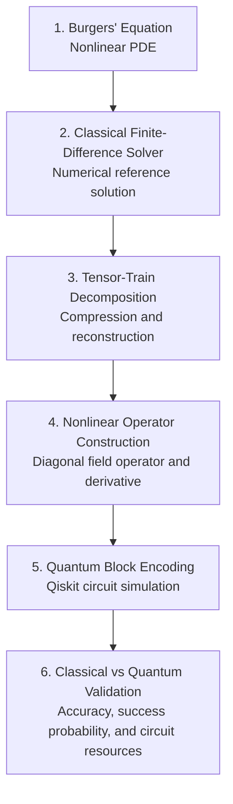

# A Qiskit-based implementation of tensor-network block encoding for non linear Quantum Computational Fluid Dynamics

**A research prototype exploring tensor-train representations and quantum algorithms for nonlinear partial differential equations (PDEs).**

## Why This Project?

Nonlinear partial differential equations are central to computational fluid dynamics (CFD), including the simulation of complex fluid flows. However, implementing nonlinear operations efficiently is a major challenge for quantum algorithms because quantum circuits implement linear unitary transformations.

This project investigates a hybrid quantum-classical approach to the Burgers' equation, focusing on a specific bottleneck: the success probability of quantum operations used to implement nonlinear terms.

### The Key Challenge: Nonlinear Operations

For the one-dimensional Burgers' equation,

$$
\frac{\partial u}{\partial t}
+u\frac{\partial u}{\partial x}
=\nu\frac{\partial^2u}{\partial x^2}
$$

the nonlinear convection term is

$$
u\frac{\partial u}{\partial x}.
$$

A state-based implementation of nonlinear multiplication can suffer from low success probabilities as the grid size increases. Low success probability can require more measurement shots to obtain reliable results, increasing the computational cost.

### Our Approach: Tensor Trains and Diagonal Block Encoding

Instead of representing nonlinear multiplication only through state-based operations, we investigate representing the velocity field as a diagonal operator:

$$
D_u=\operatorname{diag}(u_0,u_1,\ldots,u_{N-1}).
$$

The nonlinear term can then be written as

$$
D_uD_xu,
$$

where $D_x$ is the discrete spatial derivative operator.

A normalized diagonal block encoding represents

$$
\langle 0|_{\mathrm{anc}}U_u|0\rangle_{\mathrm{anc}}
=\frac{D_u}{\beta_u},
$$

where

$$
\beta_u=\|D_u\|=\max_i|u_i|.
$$

The important motivation is that this normalization depends on the maximum field magnitude rather than the field's vector $L_2$ norm, which typically grows with grid size for a field of comparable magnitude at each grid point.

For a uniform field, the research approach reports a success probability of $1$ for diagonal block encoding, compared with $1/N$ for state-based multiplication. For more general fields, the success probability depends on the field and the input state; grid-size-independent performance is not guaranteed for every problem.

Tensor-train representations provide a possible way to construct and compile these diagonal operators without explicitly storing every entry of a large dense matrix.

### Why This Matters

The project investigates whether this approach can:

- Avoid the particular success-probability scaling bottleneck associated with state-based nonlinear multiplication.
- Represent numerical fields and operators using tensor-train structures.
- Reduce the overhead associated with representing nonlinear operations.
- Validate quantum block encoding against classical numerical calculations.
- Measure the trade-offs between approximation accuracy, success probability, and circuit resources.

The goal is to test these ideas experimentally rather than assume that quantum computing automatically provides a speedup.

**Note: The tensor-network-based approach to mitigating grid-size-dependent success-probability scaling in quantum algorithms for nonlinear PDEs has been investigated in published research. We use these studies as the theoretical foundation for our project and aim to independently implement and validate the relevant techniques using Qiskit. Our focus is on diagonal block encoding, tensor-train representations, and evaluating how success probability behaves as the grid size increases. The results of our implementation will be reported separately from those established in the referenced papers.**

## 1. Overview

The Burgers' equation is a fundamental nonlinear partial differential equation used to study fluid flow, convection, diffusion, and nonlinear wave phenomena.

This project explores a hybrid quantum-classical approach to solving the one-dimensional viscous Burgers' equation. The implementation begins with a classical finite-difference solver and progressively investigates tensor-train (TT) representations, nonlinear operator construction, and quantum block encoding.

The objective for the upcoming hackathon rounds is to understand how structured tensor representations and quantum algorithms can be combined to represent and process operators arising in nonlinear PDEs.

This repository is being developed as a prototype. Classical numerical results serve as a reference for evaluating the accuracy and feasibility of the tensor and quantum components.

## 2. Problem Statement

We consider the one-dimensional viscous Burgers' equation:

$$
\frac{\partial u}{\partial t}
+u\frac{\partial u}{\partial x}
=\nu\frac{\partial^2u}{\partial x^2}.
$$

Here:

- $u(x,t)$ is the velocity field.
- $t$ is time.
- $x$ is the spatial coordinate.
- $\nu$ is the kinematic viscosity.

The initial and boundary conditions are

$$
u(x,0)=\sin(\pi x),\qquad 0\leq x\leq 1,
$$

$$
u(0,t)=u(1,t)=0.
$$

For the initial numerical experiments:

- Domain length: $L=1$
- Kinematic viscosity: $\nu=0.1$
- Number of spatial grid points: $N=8$
- Time integration: Forward Euler
- Spatial discretization: Finite differences

These parameters provide a small test case for validating the numerical formulation and exploring its tensor and quantum representations.

## 3. Project Objectives

- Implement a classical finite-difference solver for the Burgers' equation.
- Construct the discrete first- and second-derivative operators.
- Represent the nonlinear convection term using a field-dependent diagonal operator.
- Investigate tensor-train decomposition and reconstruction of the numerical solution.
- Study reconstruction errors as a function of tensor-train bond dimension.
- Explore quantum state preparation and block encoding of normalized operators using Qiskit.
- Investigate how linear and nonlinear operator branches could be combined using linear combinations of unitaries (LCU).
- Compare quantum-component simulations with classical numerical references.

## 4. Methodology

### Stage 1: Classical Numerical Solver

The spatial derivatives are approximated using finite differences, and the solution is advanced in time using the forward Euler method.

The discrete update is

$$
\begin{aligned}
u_i^{j+1}
={}&u_i^j
-\frac{\Delta t}{2\Delta x}u_i^j
\left(u_{i+1}^j-u_{i-1}^j\right)\\
&+\frac{\nu\Delta t}{\Delta x^2}
\left(u_{i+1}^j-2u_i^j+u_{i-1}^j\right).
\end{aligned}
$$

The boundary values are fixed at zero. The resulting solution is used as the classical reference.

### Stage 2: Tensor-Train Representation

The numerical solution is reshaped into a multidimensional tensor and approximated using a tensor-train representation.

The reconstruction error is evaluated using the relative $L_2$ error:

$$
\epsilon_{L_2}
=\frac{\|u-\tilde{u}\|_2}{\|u\|_2},
$$

where $u$ is the original numerical solution and $\tilde{u}$ is its tensor-train reconstruction.

Different bond dimensions are investigated to understand the trade-off between representation size and accuracy.

### Stage 3: Nonlinear Operator Construction

The diagonal matrix associated with the velocity field is defined as

$$
D_u=\operatorname{diag}(u_0,u_1,\ldots,u_{N-1}).
$$

The discrete nonlinear term can then be written as

$$
D_uD_xu,
$$

where $D_x$ is the discrete first-derivative matrix.

This representation provides a starting point for investigating how a time-dependent nonlinear operator can be represented using tensor trains.

### Stage 4: Quantum State Preparation and Block Encoding

The normalized numerical solution is represented as an amplitude-encoded quantum state:

$$
|\psi\rangle=\frac{\mathbf{u}}{\|\mathbf{u}\|_2}.
$$

For $N=8$, three system qubits are sufficient to encode the eight grid values as amplitudes.

The quantum prototype investigates block encoding, in which a normalized operator appears as a block of a larger unitary:

$$
\langle 0|_{\mathrm{anc}}U_A|0\rangle_{\mathrm{anc}}
=\frac{A}{\beta_A}.
$$

Here, $A$ is the operator being represented and $\beta_A$ is a normalization factor.

The small-system implementation is intended to validate the mathematical construction and quantum-circuit simulation before investigating more structured tensor-based compilation.

### Stage 5: Hybrid Quantum-Classical Evolution (**In progress**)

The broader approach investigates how the linear diffusion operator and nonlinear convection operator can be combined to approximate a time-evolution step.

A central challenge is representing the field-dependent nonlinear operator efficiently as the solution changes with time.

The eventual objective is to investigate a pipeline connecting classical numerical solutions, tensor-train representations, operator construction, quantum circuits, and classical optimization.

## 5. Project Workflow

The project follows a six-stage workflow, progressing from classical numerical simulation to quantum-circuit validation.



The workflow represents the planned implementation. Tensor-train-based circuit compilation and complete hybrid time evolution remain future milestones until implemented and validated.

## 6. Repository Structure

```text
hybrid-tensor-network-qcfd/
├── README.md
├── requirements.txt
├── notebooks/
│   ├── 01_burgers_classical.ipynb
│   ├── 02_tensor_train.ipynb
│   ├── 03_nonlinear_operator.ipynb
│   └── 04_qiskit_block_encoding.ipynb
└── results/
    ├── figures/
    └── data/

```


## 7. Getting Started

### Prerequisites

- Python 3.10 or a compatible Python version
- Jupyter Notebook or JupyterLab
- NumPy
- Matplotlib
- SciPy
- Qiskit

### Installation

Clone the repository:

```bash
git clone https://github.com/sukesh-0819/hybrid-tensor-network-qcfd.git
cd hybrid-tensor-network-qcfd
```

Install the dependencies:

```bash
pip install -r requirements.txt
```

Launch Jupyter Notebook:

```bash
jupyter notebook
```

**Run the notebooks in numerical order**, starting with the classical solver.

**Note:** Record and test dependency versions in `requirements.txt` before reproducing the experiments in a clean environment.

## 8. Experimental Evaluation

The project evaluates the following aspects:

- Agreement between the direct finite-difference update and its matrix-operator formulation.
- Accuracy of tensor-train reconstruction.
- Dependence of reconstruction error on bond dimension.
- Accuracy of the reconstructed nonlinear operator action.
- Unitarity of constructed block-encoding circuits.
- Agreement between the expected operator action and the simulated quantum output.
- Success probabilities and circuit-resource requirements for the small-system prototype.

Results will be documented as the corresponding implementations are completed and validated.

## 9. Current Scope and Limitations

The initial experiments use a small spatial grid to validate the mathematical and computational workflow.

An exact small-matrix unitary dilation is a useful block-encoding prototype, but it is not by itself an efficient, scalable quantum implementation. Likewise, representing an operator using a dense matrix does not demonstrate that its tensor-train representation has been compiled efficiently into a quantum circuit.

The project will distinguish between classical numerical validation, simulated quantum-circuit validation, and future work on structured tensor-based circuit construction.

No quantum speedup is assumed. Any performance advantage would require further analysis and comparison against appropriate classical baselines.

## 10. Future Work

- Investigate tensor-train compression across multiple time steps.
- Compare reconstruction accuracy for different bond dimensions.
- Develop and validate structured quantum circuits for normalized operators.
- Investigate LCU-based combination of the diffusion and convection terms.
- Evaluate circuit depth, qubit requirements, and success probabilities.
- Compare hybrid results with the classical reference solution.
- Explore larger grids and more demanding numerical test cases.

## 11. References

1. A. Termanova, A. Melnikov, E. Mamenchikov, N. Belokonev, S. Dolgov, A. Berezutskii, R. Ellerbrock, C. Mansell, and M. R. Perelshtein, "Tensor Quantum Programming," *New Journal of Physics*, vol. 26, no. 12, article 123019, 2024.  
   https://doi.org/10.1088/1367-2630/ad985b

2. P. Siegl, N.-L. van Hülst, M. Mandelt Buxadé, T. Hashizume, and D. Jaksch, "Efficient Treatment of Non-Linearity in Quantum Computational Fluid Dynamics Using Hybrid Tensor Networks," arXiv:2608.24150, 2026.  
   https://arxiv.org/abs/2608.24150

3. S.-J. Ran, "Encoding of Matrix Product States into Quantum Circuits of One- and Two-Qubit Gates," *Physical Review A*, vol. 101, 032310, 2020.  
   https://doi.org/10.1103/PhysRevA.101.032310

## 12. Contributors

- **Team:** QFluid
- **Contributors:** Sukesh Nasina, Akshay, Aaryan Sharma
- **Project track:** Open Quantum Innovation

---

*This repository is an ongoing research and development project. The README will be updated as the implementation, experiments, and results mature.*
